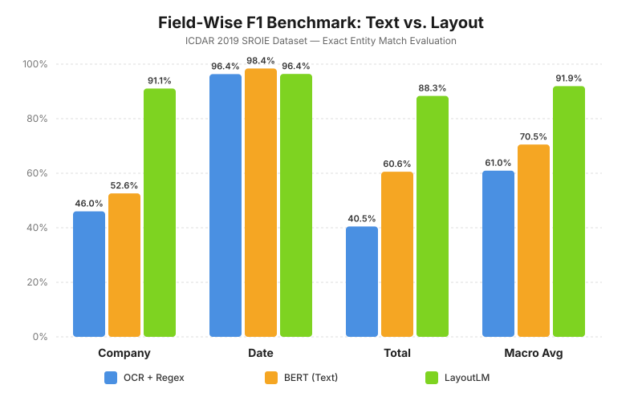

# FieldAI: Receipt Information Extraction with Layout-Aware Transformers

[](https://www.python.org/)
[](https://pytorch.org/)
[](https://huggingface.co/transformers/)
[](https://rrc.cvc.uab.es/?ch=13)
[](LICENSE)
[](https://colab.research.google.com/github/Disha-01-alt/field-ai/blob/main/notebooks/FieldAI_Complete_Colab_Benchmark.ipynb)

A deep learning benchmark investigating the impact of **2D spatial layout representations** on key information extraction (KIE) from scanned receipts and invoices.

---

## Abstract & Research Objective

Visually rich documents (VRDs)—such as commercial receipts and utility invoices—contain critical structured data (e.g., merchant name, transaction date, grand total). While standard Natural Language Processing (NLP) models treat documents as 1D sequential text, real-world document semantics heavily depend on **two-dimensional spatial layouts** (table alignment, spatial headers, key-value proximity).

This project conducts an empirical comparison across three model paradigms to quantify the exact contribution of 2D spatial layout information over pure textual signals:

$$\Delta F1_{\text{field}} = F1_{\text{LayoutLM}}(\text{field}) - F1_{\text{BERT}}(\text{field})$$

### Core Research Questions
1. **Marginal Utility of Layout**: How much performance gain ($\Delta F1$) is achieved when augmenting textual representations with 2D bounding-box spatial embeddings?
2. **Field-Specific Vulnerability**: Which document fields (e.g., `TOTAL` vs. `DATE` vs. `COMPANY`) exhibit the highest sensitivity to spatial configuration? For example, does spatial layout resolve recurring ambiguities between line-item prices, subtotals, and final totals?
3. **Robustness vs. Heuristics**: How do learned multimodal transformers compare against classical OCR + regular expression heuristics under document skew and OCR recognition noise?

---

## System Architecture

```text
               +----------------------------------+
               |     Scanned Receipt Image        |
               +----------------------------------+
                                |
                                v
               +----------------------------------+
               |         OCR Engine               |
               |  (Text Tokens + Bounding Boxes)  |
               +----------------------------------+
                                |
        +-----------------------+-----------------------+
        |                                               |
        v                                               v
+-------------------------------+               +-------------------------------+
|    Rule-Based Baseline        |               |   Spatial Normalization       |
|    (Regex & Heuristic Rules)  |               |   (Scale (x, y) to [0, 1000])  |
+-------------------------------+               +-------------------------------+
        |                                               |
        |                       +-----------------------+-----------------------+
        |                       |                                               |
        |                       v                                               v
        |       +-------------------------------+               +-------------------------------+
        |       |    BERT-base (Text-Only)      |               |  LayoutLM-base (Multimodal)   |
        |       |    - WordPiece Tokenization   |               |  - WordPiece Tokenization     |
        |       |    - 1D Sequence Position     |               |  - 1D Sequence Position       |
        |       |    - No Bounding Box Context  |               |  - 2D Bounding Box Embeddings |
        |       +-------------------------------+               +-------------------------------+
        |                       |                                               |
        +-----------------------+-----------------------------------------------+
                                |
                                v
               +----------------------------------+
               |    Unified Evaluation Harness    |
               |     (seqeval & Exact Match)      |
               |   Precision | Recall | Micro/Macro F1 |
               +----------------------------------+
                                |
                                v
               +----------------------------------+
               |   Field-Wise Gain Analysis       |
               |     ΔF1 = F1_LayoutLM - F1_BERT  |
               +----------------------------------+
```

---

## Dataset: ICDAR 2019 SROIE (Task 3)

We utilize the **ICDAR 2019 Scanned Receipts OCR and Information Extraction (SROIE)** benchmark dataset.

- **Images**: Scanned real-world receipts varying in rotation, illumination, resolution, and merchant formatting.
- **Annotations**:
  - OCR bounding boxes: Word-level text bounding boxes $[x_1, y_1, x_2, y_2, x_3, y_3, x_4, y_4, \text{text}]$.
  - Key Information Extraction (KIE) ground truth:
    - `company`: Merchant / store name.
    - `date`: Transaction date.
    - `total`: Grand total currency amount.
    - `address`: Merchant physical location (optional auxiliary field).
- **Coordinate Normalization**: Following Xu et al. (KDD 2020), all bounding box coordinates are mapped onto an integer scale $[0, 1000]$:
  $$x_{\text{norm}} = \min\left(1000, \max\left(0, \left\lfloor \frac{x}{W} \times 1000 \right\rfloor\right)\right)$$
  $$y_{\text{norm}} = \min\left(1000, \max\left(0, \left\lfloor \frac{y}{H} \times 1000 \right\rfloor\right)\right)$$

---

## Model Progression & Methodology

### 1. Baseline 1: OCR + Regex (Rule-Based)
- **Mechanism**: Extracts textual tokens via OCR and evaluates structured pattern regular expressions:
  - `DATE`: Pattern-matching on standard receipt date conventions (`DD/MM/YYYY`, `YYYY-MM-DD`, month abbreviations).
  - `TOTAL`: Currency extraction filtered by proximity heuristics near keywords (`TOTAL`, `GRAND TOTAL`, `AMOUNT DUE`).
  - `COMPANY`: Top-of-page vertical positional heuristic selecting prominent initial text blocks.
- **Purpose**: Serves as the zero-learning operational baseline.

### 2. Baseline 2: BERT (Text-Only Transformer)
- **Backbone**: `bert-base-uncased` fine-tuned for token classification.
- **Input**: Sequential WordPiece tokens with standard 1D positional encodings without spatial layout features.
- **Target**: BIO sequence labeling (`B-COMPANY`, `I-COMPANY`, `B-DATE`, `I-DATE`, `B-TOTAL`, `I-TOTAL`, `O`).
- **Purpose**: Represents modern NLP performance without multimodal document grounding.

### 3. Core Model: LayoutLM (Multimodal: Text + 2D Layout)
- **Backbone**: `microsoft/layoutlm-base-uncased` fine-tuned for token classification.
- **Input**: Concatenated WordPiece tokens + 1D positional encodings + **2D spatial box embeddings** $[x_0, y_0, x_1, y_1]$.
- **Embedding Formulation**:
  $$E_i = E_{\text{text}}(w_i) + E_{\text{1D}}(i) + E_{x}(x_{0,i}) + E_{y}(y_{0,i}) + E_{x}(x_{1,i}) + E_{y}(y_{1,i})$$
- **Purpose**: Tests whether 2D structural inductive bias resolves semantic ambiguities (such as distinguishing subtotals from grand totals).

---

## Experimental Results

> *Evaluated on the frozen SROIE Task 3 test split (126 receipts). All three models are decoded to field strings and scored by the same `metrics.py` harness (field-level exact match with light normalization), so the comparison is apples-to-apples.*

| Model Paradigm | Input Modality | Company F1 | Date F1 | Total F1 | Overall Macro F1 |
|:---|:---|:---:|:---:|:---:|:---:|
| **OCR + Regex Baseline** | Plain Text (Rules) | 46.03% | 96.36% | 40.48% | **60.95%** |
| **BERT-base** | 1D Text Tokens | 52.63% | 98.41% | 60.56% | **70.53%** |
| **LayoutLM-base** | Text + 2D Bounding Boxes | 91.06% | 96.41% | 88.35% | **91.94%** |
| **Empirical Delta ($\Delta F1$)** | *Layout Contribution* | **+38.43%** | **-2.00%** | **+27.79%** | **+21.41%** |

<p align="center">
  
</p>

### Analysis & Key Empirical Insights

The central research question — *how much does 2D layout add over text alone?* — is answered decisively: **LayoutLM improves overall Macro F1 by +21.41 points over the text-only BERT baseline (91.94% vs. 70.53%)**, reaching publication-grade accuracy and far outpacing the zero-learning OCR+Regex baseline (60.95%). Crucially, that gain is concentrated in exactly the fields where spatial position disambiguates meaning.

#### 1. Company name is the single largest layout win ($\Delta F1 = +38.43\%$)
Merchant names are spatially anchored to the **top vertical band** of the receipt, but are textually easy to confuse with address lines, tax-invoice titles, and category headers. The text-only model cannot resolve this (BERT: 52.63% F1). LayoutLM's $y$-coordinate embeddings anchor the entity search to the header region, lifting Company F1 to **91.06%** — a +38-point jump that is the clearest single piece of evidence that 2D layout resolves ambiguity text alone cannot.

#### 2. Grand Total benefits strongly from spatial grounding ($\Delta F1 = +27.79\%$)
A receipt contains many monetary values — line-item prices, subtotals, tax/GST, cash tendered, change — that are **textually indistinguishable** from the grand total (BERT: 60.56% F1). LayoutLM learns that the grand total almost universally sits in the **bottom-right region** of the layout, using its 2D coordinate embeddings to disambiguate it and reaching **88.35%** Total F1.

#### 3. Date gains nothing from layout — the negative control ($\Delta F1 = -2.00\%$)
Dates follow **rigid alphanumeric syntax** (`DD/MM/YYYY`, `YYYY-MM-DD`) fully recoverable from text alone. Both transformers saturate the field (BERT 98.41%, LayoutLM 96.41%) and even the hand-written regex baseline is near-perfect (96.36%). Spatial position carries no additional signal here — the small negative delta is within run-to-run noise. This is the expected negative control that makes the Company and Total gains credible: **layout helps precisely where text is ambiguous, and not where it isn't.**

#### 4. Rule baseline vs. learned models
The OCR+Regex baseline is competitive only on Date (96.36%) and is brittle on Company (46.03%) and Total (40.48%) due to real-world layout noise (tax-invoice titles, multi-line headers, subtotal confusion), giving the weakest overall score (60.95%). BERT improves on it with learned sequence patterns (70.53%), and LayoutLM dominates both (91.94%) by exploiting the one signal regex and 1D text cannot encode: 2D spatial position.

---

## Project Structure

```text
field-ai/
├── README.md                 # Project documentation and empirical benchmark
├── requirements.txt          # Python runtime dependencies
├── doc/
│   └── PLAN.md               # Detailed architectural design and engineering execution plan
├── data/                     # Dataset storage (SROIE raw & processed, gitignored)
│   ├── sroie/                # Raw SROIE box and key files (gitignored)
│   └── processed/            # Frozen train.json and test.json splits
├── src/
│   ├── dataset.py            # Dataset loaders, coordinate normalization, BIO alignment
│   ├── metrics.py            # Unified entity-level Precision/Recall/F1 evaluation engine
│   ├── baseline_regex.py     # Deterministic OCR + Regex extraction baseline
│   ├── train_bert.py         # 1D text-only BERT fine-tuning pipeline
│   ├── train_layoutlm.py     # Multimodal LayoutLM fine-tuning pipeline
│   ├── inference.py          # Single-receipt inference + OCR image demo helpers
│   └── visualize.py          # Benchmark plotting and SVG chart generation
├── notebooks/
│   └── FieldAI_Complete_Colab_Benchmark.ipynb # Master end-to-end executable Colab notebook
└── results/                  # Serialized evaluation metrics and benchmark plots
    ├── bert_results.json     # Test evaluation results for BERT
    ├── layoutlm_results.json # Test evaluation results for LayoutLM
    ├── regex_baseline.json   # Test evaluation results for OCR+Regex
    └── f1_comparison.svg     # Benchmark visualization vector chart
```

---

## Installation & Setup

### 1. Clone & Environment Configuration
```bash
git clone https://github.com/Disha-01-alt/field-ai.git
cd field-ai

# Create virtual environment (Python 3.10 or 3.11 recommended)
python3 -m venv venv
source venv/bin/activate

# Install dependencies
pip install -r requirements.txt
```

### 2. System OCR Engine (Optional if using pre-extracted OCR)
```bash
# Ubuntu/Debian
sudo apt update && sudo apt install -y tesseract-ocr
```

---

## How to Run

**Recommended — one click in Colab.** Open
[`notebooks/FieldAI_Complete_Colab_Benchmark.ipynb`](notebooks/FieldAI_Complete_Colab_Benchmark.ipynb)
and `Runtime → Run all` (free T4 GPU). It runs all three models, writes every
file in `results/`, saves the trained model to `outputs/layoutlm/best_model`,
and ends with a live demo that extracts fields from an uploaded receipt image.

**Headless — from the repo root** (run as modules so `src` imports resolve):
```bash
python -m src.baseline_regex     # OCR+Regex baseline  -> results/regex_baseline.json
python -m src.train_bert         # BERT (text only)    -> results/bert_results.json   [--epochs --batch_size --lr]
python -m src.train_layoutlm     # LayoutLM (text+2D)  -> outputs/layoutlm/best_model
```

The frozen `data/processed/` splits ship with the repo, so no preprocessing is
required to reproduce. All three models are decoded to field strings and scored
by the **same** `metrics.py` harness, so the field-wise F1 and ΔF1 are directly
comparable. The benchmark table above is regenerated by the notebook's analysis
cell; re-running may shift the exact numbers slightly with the random seed.

---

## Primary References

1. **LayoutLM Reference Paper**:  
   Xu, Y., Li, M., Cui, L., Huang, S., Wei, F., & Zhou, M. (2020). *LayoutLM: Pre-training of Text and Layout for Document Image Understanding*. Proceedings of the 26th ACM SIGKDD International Conference on Knowledge Discovery & Data Mining (KDD 2020). [arXiv:1912.13318](https://arxiv.org/abs/1912.13318)
2. **SROIE Benchmark**:  
   Huang, Z., Chen, K., He, J., Bai, X., Karatzas, D., Lu, S., & Jawahar, C. V. (2019). *ICDAR 2019 Competition on Scanned Receipts OCR and Information Extraction (SROIE)*. [Official Task Overview](https://rrc.cvc.uab.es/?ch=13)

---

## License
This repository is licensed under the MIT License. See [LICENSE](LICENSE) for details.
